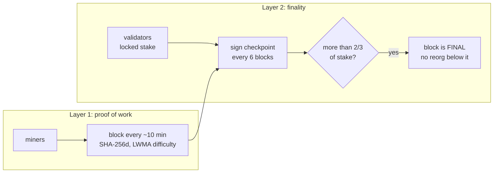
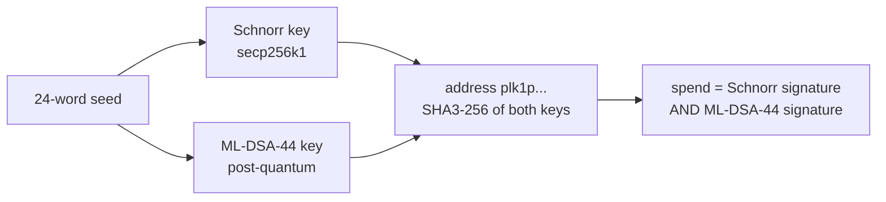
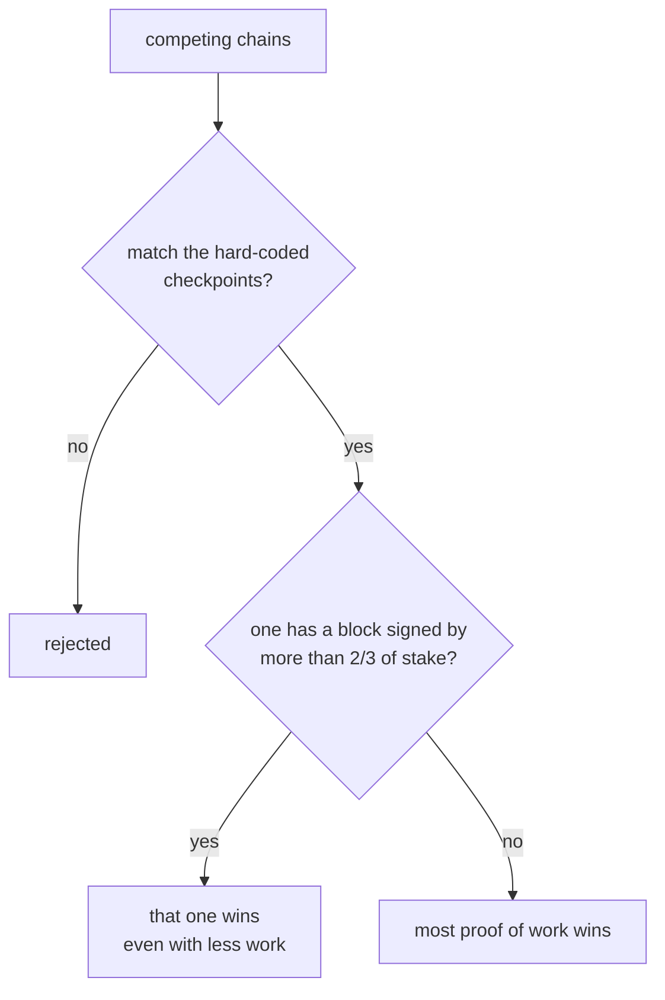

# PHYLKA (PLK)

PHYLKA is an experimental UTXO blockchain written in C++17. It combines
Bitcoin-style SHA-256d proof of work with a validator finality layer, and every
signature is hybrid (classical Schnorr plus post-quantum ML-DSA-44) from the
genesis block.

> [!WARNING]
> **PUBLIC BETA — FOR TESTING ONLY.** PHYLKA has not yet been tested at scale,
> qualified on all platforms, independently validated or **audited**. Coins may
> be lost, the chain may be reset. Not an investment, not financial advice, no
> warranty. Read **[DISCLAIMER.md](DISCLAIMER.md)** before running a node.

**How it works, in diagrams:** [docs/ARCHITECTURE.md](docs/ARCHITECTURE.md) ·
**Why PHYLKA, its dogmas and honest trade-offs:** [docs/WHY.md](docs/WHY.md) ·
**Run a node locally or on a VPS:** [docs/RUNNING.md](docs/RUNNING.md) ·
**Protocol:** [docs/PROTOCOL.md](docs/PROTOCOL.md)

## Dogmas

1. The BIP39 24-word seed is the wallet; key derivation never changes.
2. Long 63-character `plk1…` addresses commit to both keys.
3. Hybrid Schnorr + ML-DSA-44 (post-quantum) signatures from genesis.
4. 21 000 000 PLK, 50 PLK reward, halving every 210 000 blocks, no premine
   (the genesis reward is burned).
5. One network: genesis `00000000df01a464…a70a0`, pinned by checkpoints.

Details and a comparison with Bitcoin and Ethereum: [docs/WHY.md](docs/WHY.md).

## How it works

**Two layers of consensus.** Miners extend the chain with SHA-256d proof of
work, exactly like Bitcoin. Validators who lock PLK sign every 6th block; once
more than 2/3 of the stake has signed, that block is final and no amount of
hash power can reorganise it.



**Two signatures on every spend.** Each address commits to a classical
Schnorr key and a post-quantum ML-DSA-44 key. Both signatures must verify, so
an attacker has to break both schemes.



**Which chain wins.** Hard-coded checkpoints first, then finality, then work.



Twelve diagrams covering keys, transactions, block layout, difficulty, the
validator lifecycle, slashing, network splits, peer discovery, upgrades and
deployment: **[docs/ARCHITECTURE.md](docs/ARCHITECTURE.md)**.

## Design

| Item | Value |
|------|-------|
| Model | UTXO, `1 PLK = 100 000 000 fyl` |
| Supply | 21 000 000 PLK cap (`MAX_MONEY`) |
| Block reward | 50 PLK, halving every 210 000 blocks |
| Block time | 600 s (10 minutes) |
| Proof of work | double SHA-256 over a Bitcoin-compatible 80-byte header |
| Difficulty | LWMA (45-block window), retargets every block, never easier than `0x1e00ffff` |
| Max block size | 4 000 000 bytes |
| Coinbase maturity | 100 blocks (main) |
| Signatures | hybrid: secp256k1 Schnorr (BIP340) **and** ML-DSA-44 (FIPS 204); both must verify |
| Wallet | BIP39 24-word seed, account index derives hybrid keys |
| Addresses | bech32m, prefix `plk1...` (dev network `plkd1...`), 63 characters |
| Finality | validators with locked stake sign checkpoint votes; a checkpoint with more than 2/3 of the stake becomes final and cannot be reorganised |
| Main network | magic `f19c4b01`, P2P port 7333, RPC/explorer port 7334 |
| Dev network | magic `f19c4bde`, P2P port 17333, RPC/explorer port 17334 |

Main-network genesis hash:
`00000000df01a464bd9f7ad30b88da74059e25ea5b60eccaac0f95f2ba1a70a0`.

Finality parameters (main): a checkpoint every 6 blocks, validators vote when it
is 2 blocks deep, stake is locked for 1008 blocks and counts after 6 blocks, at
least 10 PLK per validator and 100 PLK total stake before finality starts.
The full specification is in [docs/PROTOCOL.md](docs/PROTOCOL.md).

Because hashing is plain SHA-256d with an unmodified 80-byte header, ordinary
SHA-256 miners can in principle mine PLK through a pool/stratum bridge. No such
bridge is included.

## Build

```sh
git clone https://github.com/a9ish1/PHYLKA.git && cd PHYLKA
```

Requirements: CMake 3.20+, a C++17 compiler with `<filesystem>` and a C11
compiler. Developed and tested with AppleClang 16 on macOS; GCC 9+ or recent
Clang is expected to work on Linux but has not been verified by the maintainers. No other dependencies; everything is vendored in `deps/`.

### macOS

```sh
xcode-select --install          # compiler, if not already installed
brew install cmake              # or any CMake >= 3.20
cmake -S . -B build -DCMAKE_BUILD_TYPE=Release
cmake --build build --parallel
./build/phylka selftest
```

macOS uses CommonCrypto for fast SHA-256 mining. Pass `-DPLK_PORTABLE_SHA=ON`
to use the portable PQClean SHA-256 everywhere instead.

### Linux

```sh
sudo apt install build-essential cmake      # Debian/Ubuntu
cmake -S . -B build -DCMAKE_BUILD_TYPE=Release
cmake --build build --parallel
./build/phylka selftest
```

On Linux the portable SHA-256 is used, randomness comes from `getrandom(2)`,
and the terminal password prompt uses termios on `/dev/tty`.

### Windows

Windows support is **experimental and currently untested**. `src/platform.*`
has Windows code paths (Winsock, BCrypt), but `src/net.cpp` still includes
POSIX headers directly, so a Windows build is not expected to succeed yet. CI
runs a Windows job that is allowed to fail.

## Quickstart (dev network)

The dev network uses trivial difficulty, 5-second blocks and short maturity,
so you can try everything on one machine in minutes. All commands take
`--dev`. Never mine or run experiments on the main network unless you know what
you are doing.

Default locations: wallet `~/phylka/wallets/<network>.wallet`, node data
`~/phylka/data/<network>/` (override with `--wallet` and `--datadir`).

1. Self-test (checks every primitive against published test vectors):

   ```sh
   ./build/phylka selftest
   ```

2. Create a wallet. You are shown 24 words once, asked to confirm two of them,
   and set a password. **Write the words on paper.**

   ```sh
   ./build/phylka wallet create --dev
   ./build/phylka wallet address --dev      # prints your plkd1... address
   ```

3. Run a node that mines to your address (RPC and explorer on 127.0.0.1:17334):

   ```sh
   ./build/phylka node --dev --mine "$(./build/phylka wallet address --dev)" --threads 2
   ```

4. In another terminal, wait for a few blocks (coinbase matures after 2 blocks
   on dev) and check the balance:

   ```sh
   ./build/phylka wallet balance --dev
   ./build/phylka wallet history --dev
   ```

5. Send a transaction. A second wallet is an easy recipient:

   ```sh
   ./build/phylka wallet create --dev --wallet /tmp/second.wallet
   ./build/phylka wallet send --dev "$(./build/phylka wallet address --dev --wallet /tmp/second.wallet)" 1.5
   ```

   The wallet prints the recipient and fee, asks `y/N`, asks for the password,
   signs locally and submits to your node.

6. Explorer: open <http://127.0.0.1:17334/> in a browser. The same port serves
   a small JSON API under `/api/` and plain-text wallet endpoints.

7. Validator finality (dev): `./build/phylka wallet stake 10 --dev` locks coins
   as stake, then run the node with `--validator` so it signs checkpoint votes.
   `wallet unstake` withdraws stake after the lock period.

### Phase 3 consensus upgrade

From height 1000 on main (`--upgrade-height`, default 20, on dev) blocks carry a
header-external extension and commitments, validators vote by registered id,
equivocators are slashed and 10% of block fees go to the validators whose votes
are in the block's finality certificate. Total supply is unchanged: fees are
redistributed, never minted. Blocks below the activation height validate exactly
as before. See `docs/PROTOCOL.md`, section 6a, for the formats.

### Network lock

The main network is pinned to the existing genesis by hard-coded checkpoints
(height 0 and 12; a block with another hash at a checkpoint height is invalid and
no chain forking below the highest checkpoint is activated), and the P2P
`version` message carries the genesis hash: peers on another genesis are
disconnected. Add newer checkpoints to `ChainParams::main()` before releases.

### Command reference

```
phylka node [--dev] [--mine ADDRESS] [--threads N] [--validator] [--wallet FILE]
            [--connect host:port]... [--addnode host:port]... [--seed host:port]... [--noseeds]
            [--port P] [--rpc R] [--datadir DIR] [--conf FILE] [--public]
            [--upgrade-height N]      (--dev only; test knob for the phase 3 activation height)
phylka wallet create|restore|address|newaddress|balance|history|send ADDRESS AMOUNT|stake AMOUNT|unstake|showseed
            [--dev] [--rpc R] [--wallet FILE]
phylka gui [--dev] [--wallet FILE] [--rpc R] [--port P] [--no-browser]
phylka selftest | newseed [--dev] | help
```

- Unknown subcommands and flags are an error (usage is printed, exit code 2);
  `--help` / `-h` print the usage and exit. Nothing is ever started by accident.
- `--connect`, `--addnode` and `--seed` take `host:port`; DNS names are resolved
  on every connection attempt. They are dialled in addition to the built-in seed
  list (`ChainParams::seeds`, empty on main until real seed nodes exist);
  `--noseeds` ignores the built-in list.
- Config file: `DIR/phylka.conf` (or `--conf FILE`), one `key=value` per line,
  keys are the long flags without `--` (`# comment` allowed; `connect`, `seed`
  and `addnode` may repeat). Command-line values win. Example:
  `dev=1`, `mine=plkd1...`, `port=17333`, `seed=seed.example.org:7333`.
- Peer discovery: nodes exchange addresses (`getaddr`/`addr`) of peers started with `--public`,
  keep an address book in `DIR/peers.dat` (max 1000) and aim for 8 outbound connections, so one
  `--seed`/`--connect` is enough to join the network. On `--dev`, loopback peers are advertised too.
- Mining guard: `--mine` waits ("waiting for sync, mining postponed") while the tip is below the last
  hard-coded checkpoint or, on main, while there are no peers and the tip is older than 24 h.
  `--mine-anyway` (dev only) turns the guard off.
- SIGINT and SIGTERM both shut the node down cleanly (systemd-friendly).
- `mkgenesis` is not part of the default build; it exists only with
  `-DPLK_ENABLE_MKGENESIS=ON` (for private networks). The main genesis is
  hard-coded and checked by `selftest`.

- The P2P listener binds to `127.0.0.1` unless `--public` is given. The RPC and
  explorer always bind to `127.0.0.1` only and have no authentication; do not
  forward that port.
- `wallet restore` rebuilds a wallet from a seed phrase.
- Run `phylka` with no arguments for the built-in help.

## Wallet

Two front ends share the same wallet code, file and keys. The seed phrase is the
wallet; the wallet file only keeps it encrypted with your password, and every
payment is signed inside the wallet process. The node only ever sees finished
transactions over its local RPC.

- **Command line:** `phylka wallet create|balance|send|...` (see the command reference).
- **GUI:** `phylka gui` starts a small local web server on `127.0.0.1` and opens the
  wallet in your browser. Everything (HTML, CSS, JavaScript, QR code generator) is
  embedded in the binary; nothing is loaded from the internet. It offers create or
  restore, balances and node status, receive address with QR code, send with a fee
  preview and confirmation screen, history with links to the local explorer, staking
  and unstaking, and a password-protected view of the recovery phrase.

```sh
./build/phylka node --dev --mine "$(./build/phylka wallet address --dev)" &   # the node, as usual
./build/phylka gui --dev                  # prints http://127.0.0.1:17335/#t=... and opens the browser
```

`phylka gui` listens on `127.0.0.1:7335` (main) or `127.0.0.1:17335` (dev); change it
with `--port`, use `--wallet FILE` and `--rpc R` as for the CLI, and `--no-browser` to
only print the link. The link carries a random session token in the URL fragment;
every API request needs it, requests with a foreign `Host` or `Origin` are refused,
and the password is asked for each signing operation and never stored. Details:
`docs/RUNNING.md`, section 2.1. The wallet is beta software like everything else here,
see `DISCLAIMER.md`.

## Running a node

Full step-by-step guide: **[docs/RUNNING.md](docs/RUNNING.md)**. Short version:

- **Local dev network (one machine, macOS or Linux):**
  ```sh
  cmake -S . -B build -DCMAKE_BUILD_TYPE=Release && cmake --build build --parallel
  ./build/phylka wallet create --dev
  ./build/phylka node --dev --mine "$(./build/phylka wallet address --dev)"
  ```
- **Several nodes on one machine:** `contrib/local-testnet.sh start 3`
  (stop with `contrib/local-testnet.sh stop`). Ports 27000+, dev network only.
- **Your own VPS (Ubuntu/Debian):** `sudo contrib/install-vps.sh` builds and installs
  `phylka` as a hardened systemd service (user `phylka`, data in `/var/lib/phylka`).
  Open only `7333/tcp`; the RPC/explorer port 7334 is loopback-only and must never be
  exposed. Reach it with `ssh -L 7334:127.0.0.1:7334 you@vps`.
- **Docker (untested):** `docker build -t phylka . && docker run -d -p 7333:7333 -v phylka-data:/data phylka`
- **Joining the PHYLKA main network:** `phylka node --public --seed HOST:7333`
  with the address of any running node (or `seed=` lines in `phylka.conf`).
  After the first connection nodes discover each other automatically.
- **Wallets belong on your own computer**, not on the server. The 24-word seed on
  paper is the only real backup.

## Security notes

- **Experimental.** The protocol and the code have not been audited. Consensus
  rules may change and the chain may be reset. There is no promise of value.
- **Not an investment.** Nothing in this repository is financial advice.
- **The seed phrase is the account.** Anyone with the 24 words (and your
  optional BIP39 passphrase) controls all your coins; losing them loses the
  coins. Write them on paper, never photograph or type them into a website.
- The wallet file holds the seed encrypted with your password
  (PBKDF2-HMAC-SHA512, 210 000 rounds, SHAKE256 keystream, HMAC tag). Use a
  long password and keep a paper backup of the seed; `.wallet` files are
  git-ignored on purpose.
- On the dev network only, the wallet accepts secrets through the environment
  variables `PHYLKA_TEST_PASSWORD`, `PHYLKA_TEST_MNEMONIC` and
  `PHYLKA_TEST_YES` for automated tests. These are ignored on the main network.
- Keep the RPC port private (it is bound to loopback and unauthenticated).
- Report vulnerabilities privately, see [SECURITY.md](SECURITY.md).

## Project status

**Public beta** — see [DISCLAIMER.md](DISCLAIMER.md).

Working: block and transaction validation, UTXO set with undo-based reorgs,
mempool with fee policy, LWMA difficulty, CPU miner with a sync guard, P2P sync
with rate limiting, ban scoring and peer discovery, hybrid-signature wallet,
validator staking, finality votes and on-chain certificates, slashing, UTXO
commitments, hard-coded checkpoints, local explorer and `selftest`.

Known gaps: no pool/stratum bridge, no public seed nodes yet (the list in
`src/chain.cpp` is empty), UTXO commitment is recomputed in full per block and
the UTXO set is rebuilt by replaying the chain at start-up (fine for a young
chain, not for a large one), no reproducible-build or release pipeline, Linux
and Windows builds not qualified, no long public testnet, **no external
security audit**.

## Repository layout

```
src/              node, wallet, networking, explorer, crypto glue
src/gui/          GUI wallet page (HTML/CSS/JS), embedded into the binary at build time
deps/             vendored libsecp256k1, PQClean ML-DSA-44/SHA-2/SHA-3, BIP39 word list
docs/PROTOCOL.md  protocol specification
docs/ARCHITECTURE.md  how it works, in diagrams
docs/RUNNING.md   build and run locally, on a VPS or in Docker
docs/WHY.md       dogmas, comparison, advantages and trade-offs
contrib/          VPS installer, systemd unit, local testnet script
tests/            multi-node test scripts (dev network)
DISCLAIMER.md     beta status: testing, qualification, validation, audit
```

## License

MIT for PHYLKA's own code, see [LICENSE](LICENSE). Vendored code keeps its
own license, see [THIRD_PARTY_NOTICES.md](THIRD_PARTY_NOTICES.md).
Contributions: [CONTRIBUTING.md](CONTRIBUTING.md).
