# PHYLKA architecture in diagrams

How the network works, piece by piece. All parameters are the main-network
values from `src/chain.cpp`; the dev network uses the same rules with faster
timings. The byte-level specification is in [PROTOCOL.md](PROTOCOL.md).

- [1. Components](#1-components)
- [2. Keys and addresses](#2-keys-and-addresses)
- [3. Life of a transaction](#3-life-of-a-transaction)
- [4. Block layout](#4-block-layout)
- [5. Proof of work and difficulty](#5-proof-of-work-and-difficulty)
- [6. Validator finality](#6-validator-finality)
- [7. Validator lifecycle](#7-validator-lifecycle)
- [8. Fork choice](#8-fork-choice)
- [9. Network split and recovery](#9-network-split-and-recovery)
- [10. Peer-to-peer sync and discovery](#10-peer-to-peer-sync-and-discovery)
- [11. Upgrade activation](#11-upgrade-activation)
- [12. Deployment](#12-deployment)

## 1. Components

One binary, `phylka`, contains the node, the miner, the validator, the wallet
and a local block explorer.

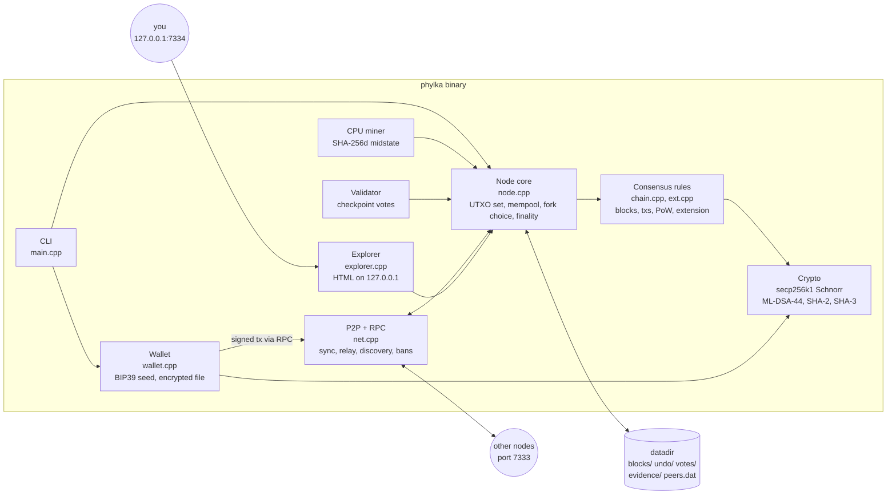

## 2. Keys and addresses

Everything comes from one BIP39 seed phrase. Every account has two key pairs,
and the address commits to both public keys, so neither can be swapped.

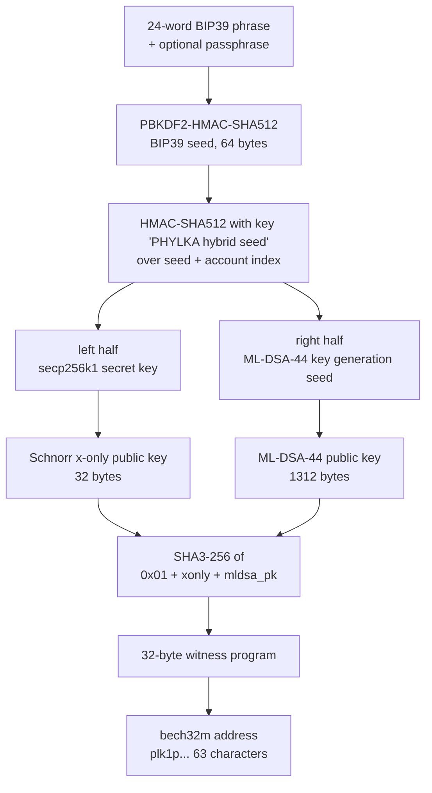

Spending needs **both** signatures over the same sighash: a Schnorr signature
(64 bytes, BIP340) and an ML-DSA-44 signature (2420 bytes, FIPS 204). Breaking
one scheme is not enough to steal coins.

## 3. Life of a transaction

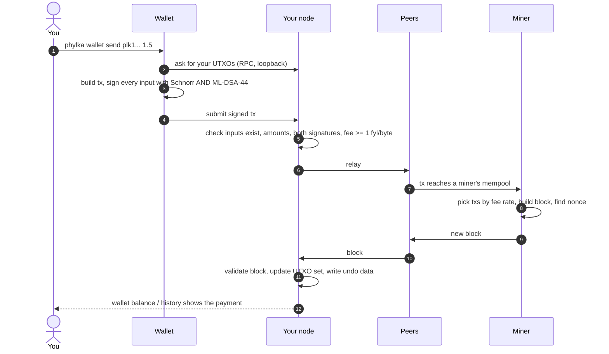

Mined coins (coinbase) can be spent after 100 blocks. Staked coins are locked
for 1008 blocks.

## 4. Block layout

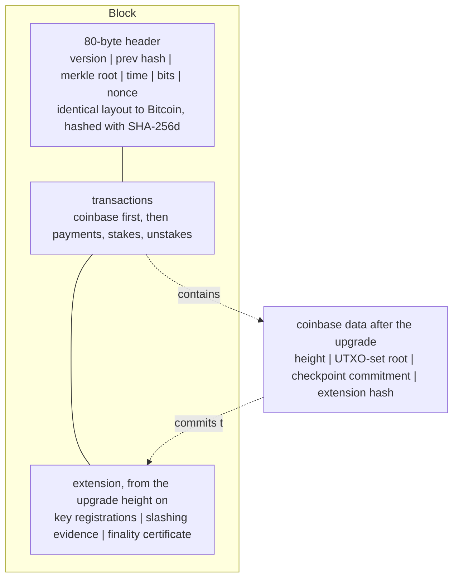

The header never changes, so any SHA-256 miner could work on PLK through a
stratum bridge. The extension sits outside the header and the merkle tree; the
coinbase commits to its hash, and the merkle root commits to the coinbase.

## 5. Proof of work and difficulty

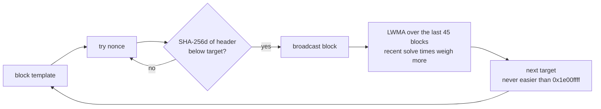

- Target spacing: 600 s. Difficulty retargets every block, so a small network
  does not stall when a miner leaves.
- Reward: 50 PLK, halving every 210 000 blocks, hard cap 21 000 000 PLK.
- Chain work is summed exactly as a 256-bit integer.

## 6. Validator finality

Proof of work orders blocks. Validators, who lock stake, make history final.

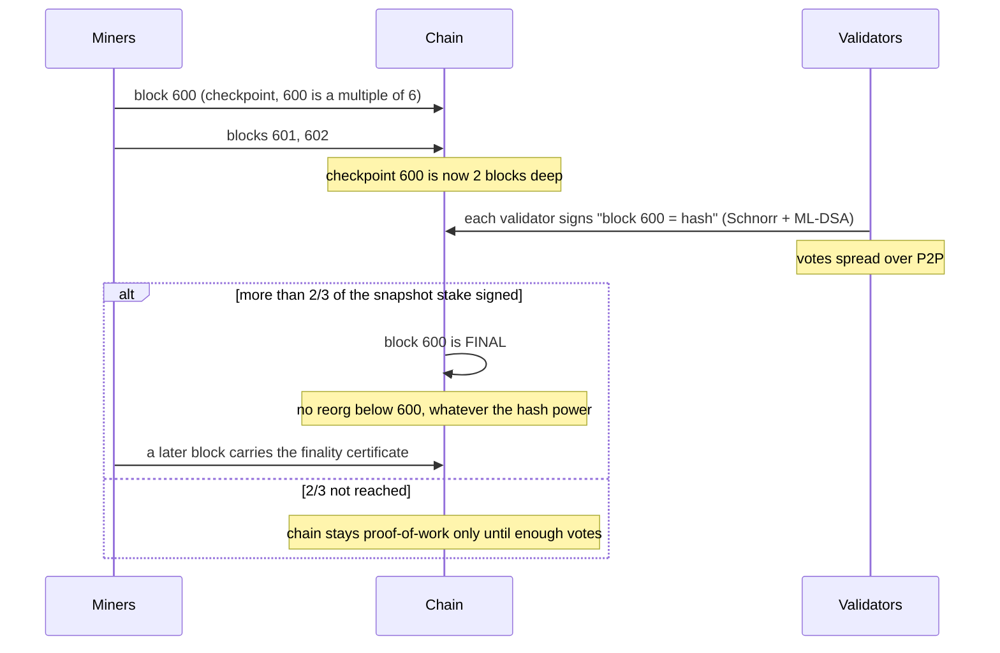

| Parameter (main) | Value |
|---|---|
| Checkpoint interval | every 6 blocks, about 1 hour |
| Vote depth | 2 blocks |
| Finality threshold | more than 2/3 of snapshot stake |
| Minimum stake | 10 PLK per validator |
| Finality starts at | 100 PLK total stake |
| Stake lock | 1008 blocks, about 1 week |
| Stake counts after | 6 blocks |
| Voter fee share | 10 % of block fees, split by stake (after the upgrade) |

The **finality certificate** (aggregated votes inside a block) lets a node that
syncs from scratch prove finality from chain data alone.

## 7. Validator lifecycle

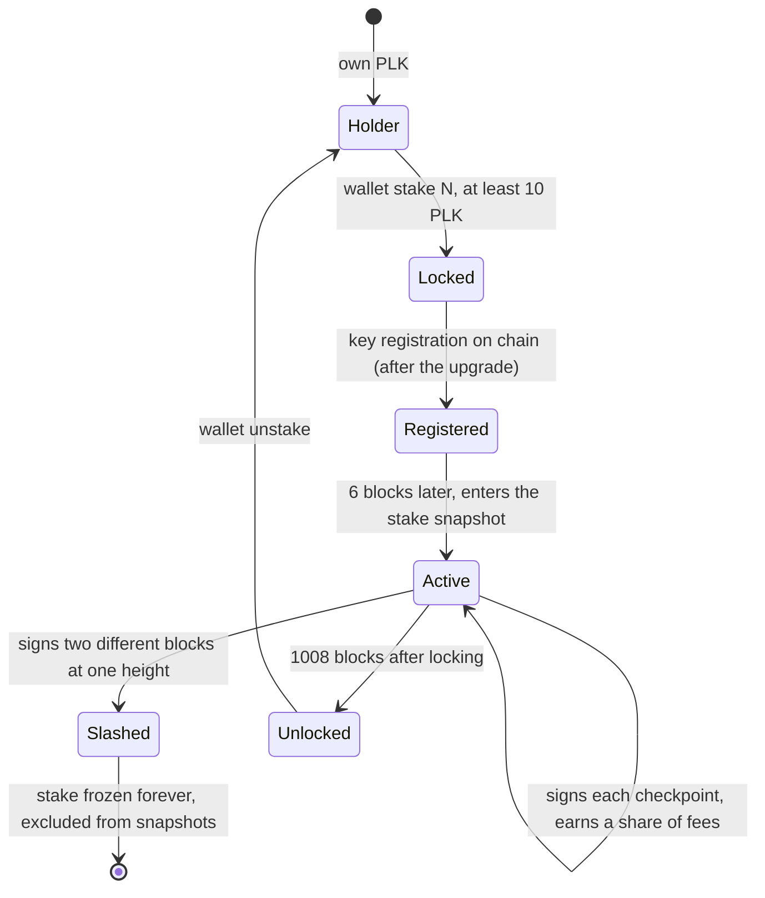

Equivocation (two signatures for different blocks at the same checkpoint
height) is provable by anyone. The evidence goes on chain and the validator's
stake can never be spent again. A validator that stays offline is not
punished; it just earns nothing.

## 8. Fork choice

How a node decides which chain is the real one, in order of priority.

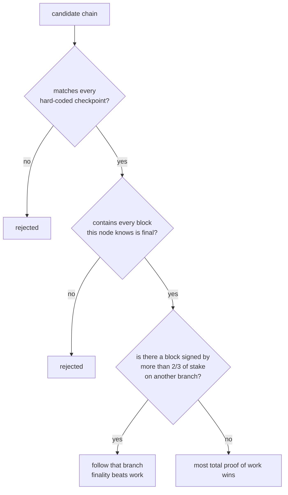

Hard-coded checkpoints pin the network to genesis
`00000000df01a464…a70a0`. Nodes also compare the genesis hash in the handshake
and drop peers from any other network.

## 9. Network split and recovery

Tested in `tests/test-splitbrain.sh`.

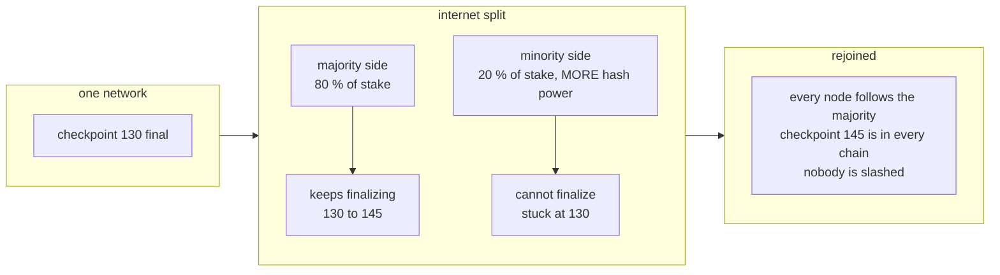

If neither side has more than 2/3 of the stake, neither finalizes during the
split; after rejoining the nodes converge on the chain with more work and
finality resumes.

## 10. Peer-to-peer sync and discovery

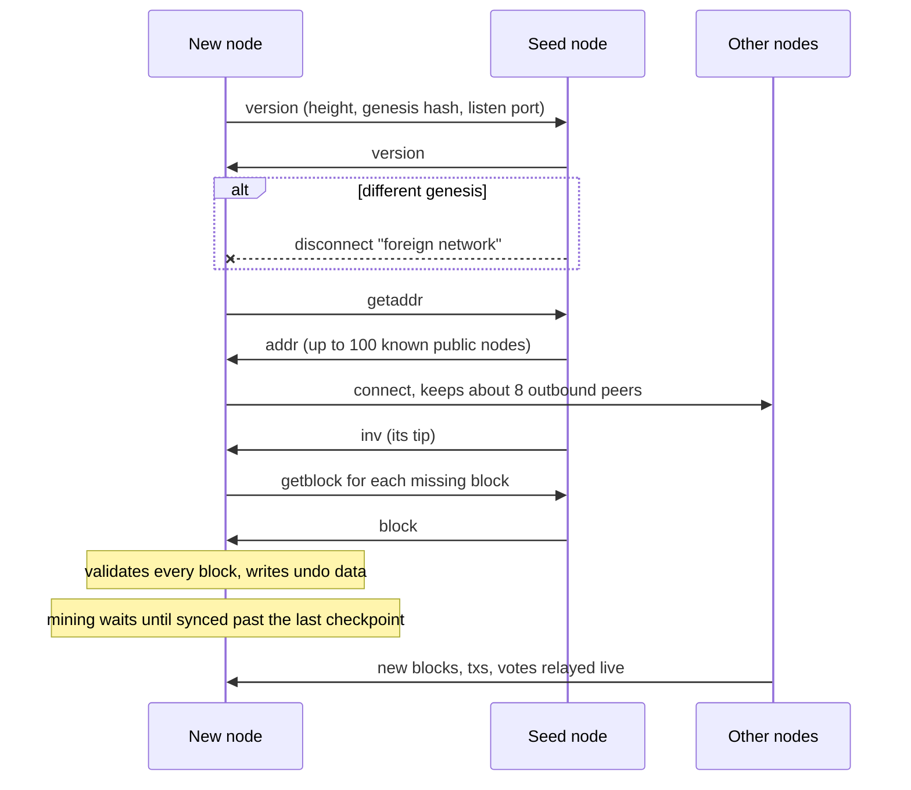

Protections: per-peer rate limits, size caps checked before allocation,
32 inbound peers (4 per IP), misbehaviour score with 24 h bans, handshake
timeout. The RPC/explorer port listens on 127.0.0.1 only.

## 11. Upgrade activation

New consensus rules switch on at a fixed height, so the early chain stays
valid exactly as it was mined.

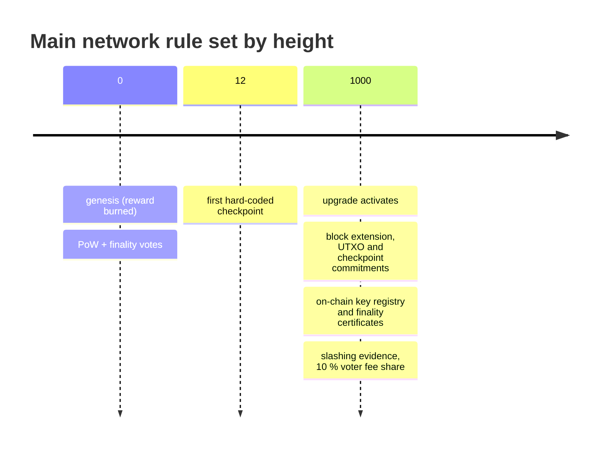

## 12. Deployment

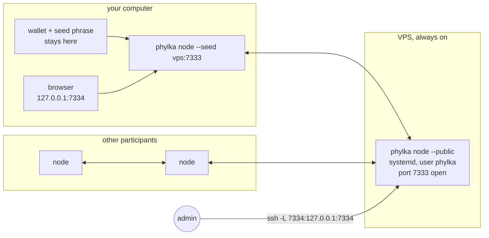

Step-by-step setup for every box in this picture: [RUNNING.md](RUNNING.md).
